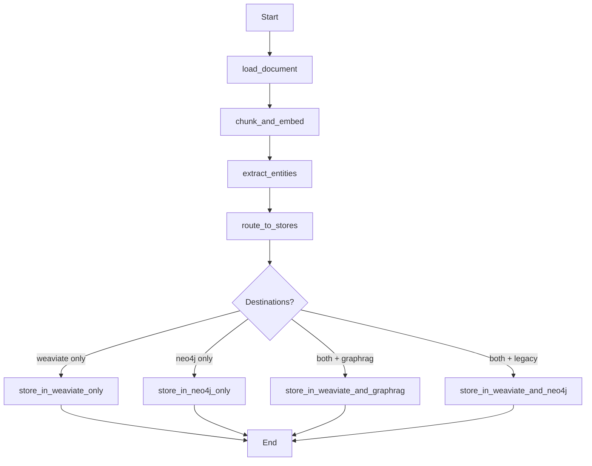

# Ingestion Pipeline Documentation

## Overview

The ingestion pipeline is a LangGraph-based system that processes documents through multiple stages, extracting content, generating embeddings, identifying entities, and storing data in appropriate data stores with multi-tenancy support.

## Architecture

### State Schema

The [`IngestionState`](graph.py:25) TypedDict defines the complete state flowing through the pipeline:

```python
class IngestionState(TypedDict):
    input_data: Dict[str, Any]          # File path or content + metadata
    processed_chunks: Optional[List]     # Chunked text with metadata
    embeddings: Optional[List]           # Embeddings for each chunk
    entities: Optional[Dict]             # Extracted entities and relations
    destinations: Optional[List[str]]    # Routing destinations
    tenant_id: str                       # Tenant identifier
    error: Optional[str]                 # Error message if any
```

### Pipeline Nodes

#### 1. Load Document ([`load_document`](nodes.py:33))

**Purpose**: Parse files or content using LangChain loaders

**Supported Formats**:
- PDF files (`.pdf`) - via [`PyPDFLoader`](nodes.py:55)
- Text files (`.txt`) - via [`TextLoader`](nodes.py:58)
- CSV files (`.csv`) - via [`CSVLoader`](nodes.py:61)
- Other formats - via [`UnstructuredFileLoader`](nodes.py:65)

**Input**:
- `input_data`: Dictionary with either:
  - `file_path`: Path to file
  - `content`: Direct text content
  - `metadata`: Optional metadata dict

**Output**:
- Updates `input_data` with parsed content and enriched metadata
- Generates unique `document_id`
- Adds `tenant_id` to metadata

**Example**:
```python
input_data = {
    "file_path": "/path/to/document.pdf",
    "metadata": {"source": "user_upload"}
}
result = load_document(input_data, tenant_id="company_123")
```

#### 2. Chunk and Embed ([`chunk_and_embed`](nodes.py:112))

**Purpose**: Split text into chunks and generate embeddings

**Configuration**:
- Chunk size: 1000 characters
- Chunk overlap: 200 characters
- Embedding model: OpenAI [`text-embedding-ada-002`](../core/config.py:56)

**Process**:
1. Uses [`RecursiveCharacterTextSplitter`](nodes.py:130) for intelligent text splitting
2. Generates embeddings via [`OpenAIEmbeddings`](nodes.py:154)
3. Assigns unique `chunk_id` to each chunk

**Input**:
- `input_data`: Content and metadata from load_document

**Output**:
- `processed_chunks`: List of chunk dictionaries with content and metadata
- `embeddings`: List of embedding vectors (1536 dimensions)

#### 3. Extract Entities ([`extract_entities`](nodes.py:174))

**Purpose**: Extract named entities and relationships using LLM

**Entity Types**:
- PERSON
- ORGANIZATION
- LOCATION
- DATE
- EVENT
- PRODUCT
- CONCEPT

**Process**:
1. Prompts GPT-4 to extract entities and relationships as JSON
2. Deduplicates entities by name and type
3. Links entities to source chunks and documents

**Input**:
- `processed_chunks`: Text chunks with metadata

**Output**:
- `entities`: Dictionary containing:
  - `entities`: List of unique entities with id, name, type
  - `relationships`: List of relationships with source_id, target_id, type, description

**Example Output**:
```json
{
  "entities": [
    {"id": "e1", "name": "John Doe", "type": "PERSON"},
    {"id": "e2", "name": "Acme Corp", "type": "ORGANIZATION"}
  ],
  "relationships": [
    {
      "source_id": "e1",
      "target_id": "e2", 
      "type": "WORKS_FOR",
      "description": "John Doe is employed by Acme Corp"
    }
  ]
}
```

#### 4. Route to Stores ([`route_to_stores`](nodes.py:278))

**Purpose**: Determine destination data stores based on content type

**Routing Logic**:
- **Weaviate**: Always included for vector search
- **Neo4j**: Added if entities were detected (len(entities) > 0)

**Input**:
- `processed_chunks`: Text chunks
- `embeddings`: Embedding vectors
- `entities`: Extracted entities

**Output**:
- `destinations`: List of store names (e.g., `["weaviate", "neo4j"]`)

### Storage Nodes

#### Store in Weaviate ([`store_in_weaviate`](nodes.py:319))

**Purpose**: Store document chunks and embeddings for vector search

**Features**:
- Validates tenant isolation via [`validate_metadata`](../core/security.py:51)
- Uses pre-computed embeddings (no re-computation)
- Supports async parallel writes via [`store_in_weaviate_async`](nodes.py:355)

**Multi-tenancy**: Enforces `tenant_id` in all stored documents

#### Store in Neo4j ([`store_in_neo4j`](nodes.py:392))

**Purpose**: Store entities and relationships in knowledge graph

**Graph Structure**:
```
(Document)-[:MENTIONS]->(Entity)-[RELATIONSHIP]->(Entity)
```

**Features**:
- Creates document nodes
- Links entities to documents
- Establishes entity relationships
- Async support via [`store_in_neo4j_async`](nodes.py:456)

**Multi-tenancy**: All nodes include `tenant_id` property

#### Store in Neo4j GraphRAG ([`store_in_neo4j_graphrag`](nodes.py:484))

**Purpose**: Build advanced knowledge graph using Neo4j GraphRAG pipeline

**Features**:
- Constructs full-text from all chunks
- Uses GraphRAG for sophisticated entity extraction
- Async support via [`store_in_neo4j_graphrag_async`](nodes.py:527)

**Advantages**:
- Better relationship detection
- Community detection
- Enhanced graph traversal

## Graph Flow



## Async Parallel Processing

The pipeline supports **parallel async writes** to multiple data stores:

### Parallel Weaviate + Neo4j ([`_store_in_weaviate_and_neo4j`](graph.py:317))

```python
async def store_parallel():
    await asyncio.gather(
        store_in_weaviate_async(...),
        store_in_neo4j_async(...)
    )
```

### Parallel Weaviate + GraphRAG ([`_store_in_weaviate_and_graphrag`](graph.py:352))

```python
async def store_parallel():
    tasks = [store_in_weaviate_async(...)]
    if graphrag_client:
        tasks.append(store_in_neo4j_graphrag_async(...))
    await asyncio.gather(*tasks)
```

**Benefits**:
- Reduced latency (parallel vs sequential)
- Better resource utilization
- Automatic fallback to sync on failure

## Multi-Tenancy & Security

### Tenant Isolation

All data is isolated by `tenant_id`:

1. **Extracted from JWT** in [`get_current_user`](../api/dependencies.py:104)
2. **Validated** via [`validate_tenant_access`](../core/security.py:11)
3. **Enforced in metadata** via [`validate_metadata`](../core/security.py:51)
4. **Stored with all objects** in Weaviate and Neo4j

### Security Functions

- [`validate_tenant_access`](../core/security.py:11): Ensures user has access to tenant
- [`ensure_tenant_isolation`](../core/security.py:32): Adds/validates tenant_id in data
- [`validate_metadata`](../core/security.py:51): Validates and enriches metadata

## Usage

### Basic Ingestion

```python
from src.ingestion.graph import IngestionGraph
from src.data_stores import WeaviateClient, Neo4jClient

# Initialize clients
weaviate = WeaviateClient()
neo4j = Neo4jClient()

# Create graph
graph = IngestionGraph(
    postgres_client=postgres,
    weaviate_client=weaviate,
    neo4j_client=neo4j,
    use_graphrag=True
)

# Ingest document
result = graph.ingest_document(
    input_data={
        "file_path": "/path/to/doc.pdf",
        "metadata": {"source": "upload"}
    },
    tenant_id="company_123"
)
```

### Async Ingestion

```python
# Async version for better performance
result = await graph.ingest_document_async(
    input_data={
        "content": "Large document text...",
        "metadata": {"source": "api"}
    },
    tenant_id="company_123"
)
```

### API Endpoint Usage

```bash
# Upload file
curl -X POST "http://localhost:8000/api/v1/ingest/file" \
  -H "Authorization: Bearer <token>" \
  -F "file=@document.pdf" \
  -F 'metadata={"source": "user_upload"}'

# Ingest from URL
curl -X POST "http://localhost:8000/api/v1/ingest/url" \
  -H "Authorization: Bearer <token>" \
  -H "Content-Type: application/json" \
  -d '{
    "url": "https://example.com/article",
    "metadata": {"source": "web"}
  }'

# Direct content
curl -X POST "http://localhost:8000/api/v1/ingest/document" \
  -H "Authorization: Bearer <token>" \
  -H "Content-Type: application/json" \
  -d '{
    "content": "Document text here...",
    "metadata": {"title": "My Document"}
  }'
```

## Error Handling

The pipeline includes comprehensive error handling:

1. **Node-level**: Each node catches exceptions and sets `error` in state
2. **Graph-level**: Graph checks for errors before proceeding
3. **Storage-level**: Async operations have sync fallbacks
4. **Logging**: All errors logged with context via logger

**Error Flow**:
```python
if state.get("error"):
    return state  # Skip processing, propagate error
```

## Configuration

### Environment Variables

```bash
# OpenAI (required)
OPENAI_API_KEY=sk-...
EMBEDDING_MODEL=text-embedding-ada-002
LLM_MODEL=gpt-4-turbo

# Weaviate (required)
WEAVIATE_URL=https://...
WEAVIATE_API_KEY=...

# Neo4j (required)
NEO4J_URI=bolt://localhost:7687
NEO4J_USER=neo4j
NEO4J_PASSWORD=password
```

### Chunking Parameters

Edit in [`chunk_and_embed`](nodes.py:130):
```python
text_splitter = RecursiveCharacterTextSplitter(
    chunk_size=1000,        # Adjust chunk size
    chunk_overlap=200,      # Adjust overlap
    length_function=len,
)
```

### Entity Extraction Prompt

Customize in [`extract_entities`](nodes.py:199):
```python
prompt = f"""
Extract named entities and their relationships...
Entity types: PERSON, ORGANIZATION, LOCATION...
"""
```

## Performance Considerations

### Optimization Tips

1. **Use async methods** for better throughput
2. **Batch operations** when processing multiple documents
3. **Pre-compute embeddings** to avoid redundant API calls
4. **Adjust chunk size** based on your use case:
   - Smaller chunks (500): Better precision, more storage
   - Larger chunks (2000): Better context, fewer API calls

### Monitoring

Monitor these metrics:
- Document processing time
- Embedding generation time
- Storage write latency
- Error rates per tenant

## Testing

Run ingestion tests:

```bash
# Unit tests
pytest tests/ingestion/test_ingestion_pipeline.py -v

# Integration tests
ENABLE_INTEGRATION_TESTS=true pytest tests/ingestion/test_integration.py -v
```

## Related Documentation

- [API Endpoints](../api/v1/endpoints/ingest.py)
- [Security Module](../core/security.py)
- [Weaviate Client](../data_stores/weaviate_client.py)
- [Neo4j Client](../data_stores/neo4j_client.py)
- [GraphRAG Client](../data_stores/neo4j_graphrag_client.py)